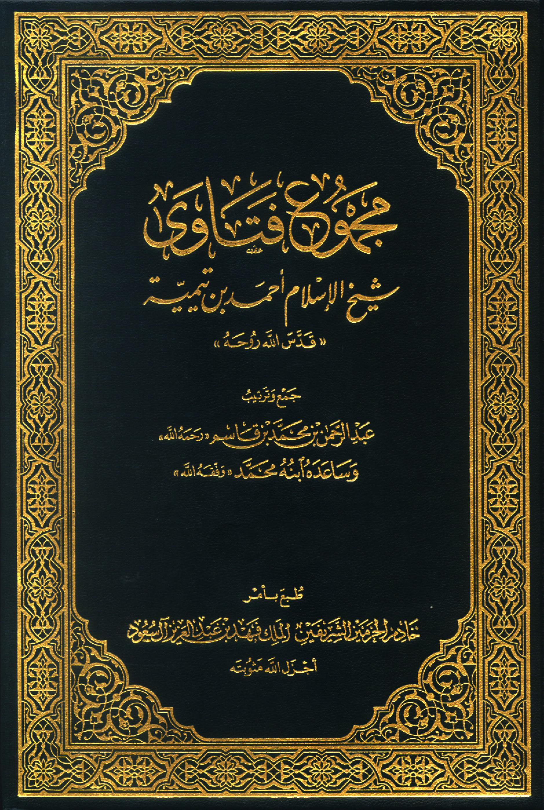

<div align="center">



# Majmu' al-Fatawa (مجموع الفتاوى)
### The Complete Collection of Fatwas by Shaykh al-Islām Ibn Taymiyyah
**Complete Bilingual Dataset: Original Arabic & Full English Translation**

[](#volumes-table)
[](#dataset-schema)
[](#dataset-summary)
[](#dataset-summary)
[](#file-structure)
[](https://creativecommons.org/licenses/by/4.0/)

</div>

---

## 📖 Overview

**Majmu' al-Fatawa** (*The Compendium of Legal Verdicts*) is the monumental 37-volume theological, jurisprudential, and philosophical encyclopedia compiled by **Shaykh al-Islām Taqī ad-Dīn Ahmad ibn 'Abd al-Halīm ibn Taymiyyah** (661–728 AH / 1263–1328 CE), systematically collected and edited in the 20th century by **Shaykh 'Abd ar-Rahmān ibn Muhammad ibn Qāsim al-'Āsimī an-Najdī** and his son Muhammad.

It constitutes one of the largest and most influential reference works in the Islamic tradition, covering Islamic creed (*'Aqīdah*), divine unity (*Tawhīd*), scholastic theology, Quranic exegesis (*Tafsīr*), principles of jurisprudence (*Usūl al-Fiqh*), substantive law (*Fiqh*), spirituality (*Sulūk* and *Tasawwuf*), logic (*Mantiq*), hadith criticism, and socio-political ethics.

This repository provides the **complete, aligned bilingual dataset** (Arabic original and English translation) of all **16,874 pages across all 37 tomes**, extracted from [Kutub.io](https://kutub.io/en/book/7289) (Book ID `7289`).

---

## 📊 Dataset Summary

| Attribute | Specification |
| :--- | :--- |
| **Author** | Shaykh al-Islām Ahmad ibn Taymiyyah (شيخ الإسلام ابن تيمية) |
| **Compiler** | Shaykh 'Abd ar-Rahmān ibn Muhammad ibn Qāsim (عبد الرحمن بن قاسم) |
| **Source Platform** | [Kutub.io (Book 7289)](https://kutub.io/en/book/7289) |
| **Total Volumes (Tomes)** | **37 volumes** (35 numbered volumes + *al-Muqaddimah* + *Volume 3 Supplement*) |
| **Total Pages** | **16,874 pages** (100% coverage, 0 missing, 0 empty) |
| **Translation Status** | **100% translated** to English with full scholarly footnotes |
| **Available Formats** | SQLite 3 (`.db`), JSON Lines (`.jsonl`), Markdown (`.md`), Plain Text (`.txt`), Structured JSON (`.json`) |
| **Primary Identifier** | Sequential Page ID (`1` through `16874`) & Kutub UUID (`page_key`) |

---

## 📚 Volumes Table

Below is the complete inventory of all 37 tomes included in this dataset:

| Tome # | Volume Directory | Topic / Subject (English) | Arabic / Transliteration | Pages | Range |
| :---: | :--- | :--- | :--- | :---: | :---: |
| **00** | `tomes/tome_00_muqaddimah` | Introduction & Index of Works | المقدمة / al-Muqaddimah | 2 | 1 – 2 |
| **01** | `tomes/tome_01` | Tawḥīd al-Ulūhiyya (Oneness of Divinity) | توحيد الألوهية | 380 | 3 – 382 |
| **02** | `tomes/tome_02` | Tawḥīd al-Rubūbiyya (Oneness of Lordship) | توحيد الربوبية | 495 | 383 – 877 |
| **03** | `tomes/tome_03` | Concise Statement of the Salaf's Creed | مجمل اعتقاد السلف | 430 | 878 – 1322 |
| **03-A**| `tomes/tome_03_supplement`| Creed Supplement | تتمة العقيدة | 15 | 966 – 980 |
| **04** | `tomes/tome_04` | Detailed Statement of the Salaf's Creed | مفصل اعتقاد السلف | 542 | 1323 – 1864 |
| **05** | `tomes/tome_05` | Divine Names and Attributes I | الأسماء والصفات (١) | 578 | 1865 – 2442 |
| **06** | `tomes/tome_06` | Divine Names and Attributes II | الأسماء والصفات (٢) | 597 | 2443 – 3039 |
| **07** | `tomes/tome_07` | Faith (al-Īmān) | كتاب الإيمان | 682 | 3040 – 3721 |
| **08** | `tomes/tome_08` | Divine Decree & Predestination (al-Qadar) | القدر | 548 | 3722 – 4269 |
| **09** | `tomes/tome_09` | Logic & Epistemology (al-Manṭiq) | المنطق | 315 | 4270 – 4584 |
| **10** | `tomes/tome_10` | The Science of Spiritual Conduct (ʿIlm as-Sulūk) | علم السلوك | 765 | 4585 – 5349 |
| **11** | `tomes/tome_11` | Tasawwuf & Spiritual Realities (at-Taṣawwuf) | التصوف | 698 | 5350 – 6047 |
| **12** | `tomes/tome_12` | The Qur'an is the Uncreated Speech of God | القرآن كلام الله | 596 | 6048 – 6643 |
| **13** | `tomes/tome_13` | Principles of Qur'anic Exegesis (Usūl at-Tafsīr) | مقدمة في أصول التفسير | 420 | 6644 – 7063 |
| **14** | `tomes/tome_14` | Tafsīr 1: Sūrat al-Fātiḥah to al-Aʿrāf | تفسير (١): الفاتحة - الأعراف | 498 | 7064 – 7561 |
| **15** | `tomes/tome_15` | Tafsīr 2: Sūrat al-Aʿrāf to al-Aḥzāb | تفسير (٢): الأعراف - الأحزاب | 448 | 7562 – 8009 |
| **16** | `tomes/tome_16` | Tafsīr 3: Sūrat az-Zumar to al-Masad | تفسير (٣): الزمر - تبت | 599 | 8010 – 8608 |
| **17** | `tomes/tome_17` | Tafsīr 4: Sūrat al-Ikhlāṣ to an-Nās | تفسير (٤): الإخلاص - الناس | 532 | 8609 – 9140 |
| **18** | `tomes/tome_18` | Hadith Sciences & Traditions (al-Ḥadīth) | الحديث | 381 | 9141 – 9521 |
| **19** | `tomes/tome_19` | Usūl al-Fiqh 1: Following the Sunnah (al-Ittibāʿ) | أصول الفقه (١): الاتباع | 307 | 9522 – 9828 |
| **20** | `tomes/tome_20` | Usūl al-Fiqh 2: Adherence to Madhhabs & Ijtihād | أصول الفقه (٢): التمذهب | 581 | 9829 – 10409 |
| **21** | `tomes/tome_21` | Fiqh 1: Ritual Purity (aṭ-Ṭahārah) | الفقه (١): الطهارة | 632 | 10410 – 11041 |
| **22** | `tomes/tome_22` | Fiqh 2: Prayer (aṣ-Ṣalāh) | الفقه (٢): الصلاة | 622 | 11042 – 11663 |
| **23** | `tomes/tome_23` | Fiqh 3: Prayer (Continued) | الفقه (٣): بقية الصلاة | 410 | 11664 – 12073 |
| **24** | `tomes/tome_24` | Fiqh 4: Congregational Prayer & Funerals (al-Janā'iz) | الفقه (٤): الجنائز | 379 | 12074 – 12452 |
| **25** | `tomes/tome_25` | Fiqh 5: Zakat & Fasting (az-Zakāh wa aṣ-Ṣiyām) | الفقه (٥): الزكاة والصيام | 328 | 12453 – 12780 |
| **26** | `tomes/tome_26` | Fiqh 6: Pilgrimage (al-Ḥajj) | الفقه (٦): الحج | 308 | 12781 – 13088 |
| **27** | `tomes/tome_27` | Fiqh 7: Visitation of Graves & Shrines (az-Ziyārah) | الفقه (٧): الزيارة | 507 | 13089 – 13595 |
| **28** | `tomes/tome_28` | Fiqh 8: Jihād & Governance (al-Jihād) | الفقه (٨): الجهاد | 664 | 13596 – 14259 |
| **29** | `tomes/tome_29` | Fiqh 9: Sales & Commercial Contracts (al-Buyūʿ) | الفقه (٩): البيوع | 553 | 14260 – 14812 |
| **30** | `tomes/tome_30` | Fiqh 10: Conciliation & Property (aṣ-Ṣulḥ wa al-Luqaṭah) | الفقه (١٠): الصلح واللقطة | 412 | 14813 – 15224 |
| **31** | `tomes/tome_31` | Fiqh 11: Endowments & Manumission (al-Waqf wa al-ʿItq) | الفقه (١١): الوقف والعتق | 382 | 15225 – 15606 |
| **32** | `tomes/tome_32` | Fiqh 12: Marriage & Dowry (an-Nikāḥ) | الفقه (١٢): النكاح | 358 | 15607 – 15964 |
| **33** | `tomes/tome_33` | Fiqh 13: Divorce (aṭ-Ṭalāq) | الفقه (١٣): الطلاق | 243 | 15965 – 16207 |
| **34** | `tomes/tome_34` | Fiqh 14: Injurious Assimilation & Penal Laws (aẓ-Ẓihār wa al-Ḥudūd) | الفقه (١٤): الظهار والحدود | 240 | 16208 – 16447 |
| **35** | `tomes/tome_35` | Fiqh 15: Rebellion, Judicial Admissions & Legal Oaths | الفقه (١٥): قتال أهل البغي والإقرار | 427 | 16448 – 16874 |

---

## 📁 Repository Structure

```tree
majmu_al_fatawa/
├── cover.jpg                   # High-resolution book cover image (1.0 MB)
├── metadata.json               # Core book & author catalog metadata
├── book_details.json           # Detailed catalog statistics, categories, descriptions
├── navigation.json             # Volume list and page-range mapping
├── table_of_contents.json      # Full 36-section hierarchical chapter tree
├── unpack.py                   # Automatic decompressor for .db.gz and .jsonl.gz
├── scrape_majmu.ts             # Complete reproduction / scraper script
├── package.json                # Project descriptor & scripts
│
├── majmu_al_fatawa.db.gz       # Gzipped SQLite3 database (26.1 MB, uncompressed 181 MB)
├── all_pages.jsonl.gz          # Gzipped JSON Lines file (21.5 MB, uncompressed 84 MB)
│
└── tomes/                      # 37 directories, one per volume
    ├── tome_00_muqaddimah/
    │   ├── pages.json          # Structured JSON array of pages
    │   ├── english.md          # Formatted Markdown with English text and footnotes
    │   └── arabic.txt          # Original Arabic text with footnotes
    ├── tome_01/
    │   ├── pages.json
    │   ├── english.md
    │   └── arabic.txt
    └── ... (through tome_35)
```

---

## 🗄️ Database Schema (`majmu_al_fatawa.db`)

Once unpacked (`python unpack.py`), `majmu_al_fatawa.db` contains the table `pages`:

```sql
CREATE TABLE pages (
    page_id                   INTEGER PRIMARY KEY,  -- Global page index (1 to 16,874)
    tome                      TEXT,                 -- Volume designation (e.g., '1', '10', 'المقدمة')
    page_key                  TEXT,                 -- Kutub UUID identifier
    original_text             TEXT,                 -- Full Arabic page text
    original_footnote         TEXT,                 -- Arabic footnotes
    translated_text           TEXT,                 -- Full English translation
    translated_footnote       TEXT,                 -- English footnotes
    corrected_translated_text TEXT,                 -- Revisions / editorial corrections (JSON array)
    has_next_page             INTEGER,              -- 1 if next page exists, 0 otherwise
    raw_json                  TEXT                  -- Raw Kutub API response payload
);

CREATE INDEX idx_pages_tome ON pages(tome);
```

---

## 🚀 Quick Start

### 1. Unpack Database & JSONL

The repository stores `majmu_al_fatawa.db.gz` and `all_pages.jsonl.gz` to ensure fast cloning under GitHub file size limits. Run the unpacker once to generate the uncompressed database:

```bash
# Using Python:
python unpack.py

# Or using Bun / Node:
bun run unpack
```

### 2. Querying with Python (SQLite)

```python
import sqlite3

conn = sqlite3.connect("majmu_al_fatawa.db")
cursor = conn.cursor()

# 1. Fetch a specific page (e.g. Page 100)
cursor.execute("SELECT tome, original_text, translated_text FROM pages WHERE page_id = 100")
tome, arabic, english = cursor.fetchone()
print(f"=== Tome {tome} | Page 100 ===")
print("English Translation:\n", english[:300])

# 2. Search English text for a keyword
cursor.execute("""
    SELECT page_id, tome, translated_text 
    FROM pages 
    WHERE translated_text LIKE '%tawhid%' 
    LIMIT 5
""")
for pid, vol, text in cursor.fetchall():
    print(f"Page {pid} (Volume {vol}): {text[:120]}...\n")

conn.close()
```

### 3. Reading with Pandas & JSONL

```python
import pandas as pd
import gzip

# Read directly from compressed JSONL without decompressing to disk:
with gzip.open("all_pages.jsonl.gz", "rt", encoding="utf-8") as f:
    df = pd.read_json(f, lines=True)

print("Total records loaded:", len(df))
print(df[["page_id", "tome", "translated_text"]].head())
```

### 4. Direct SQLite CLI Queries

```bash
# Launch interactive SQLite shell
sqlite3 majmu_al_fatawa.db

-- Count total pages per volume
SELECT tome, COUNT(*) AS page_count, MIN(page_id) AS start_page, MAX(page_id) AS end_page
FROM pages 
GROUP BY tome 
ORDER BY MIN(page_id);

-- Find discussions on intention (niyyah) in Volume 1
SELECT page_id, translated_text 
FROM pages 
WHERE tome = '1' AND translated_text LIKE '%intention%' 
LIMIT 3;
```

---

## 🔍 Quality & Completeness Proof

Every page has been programmatically inspected and verified:

```text
============================================================
DATA INTEGRITY VERIFICATION REPORT
============================================================
Total Expected Pages:         16,874
Pages in SQLite Database:     16,874 (100.0%)
Pages in all_pages.jsonl:     16,874 (100.0%)
Pages with Missing Arabic:    0
Pages with Missing English:   0
Number of Volumes (Tomes):    37
Page ID Sequence:             Strict 1..16874 contiguous
============================================================
```

---

## 🛠️ Reproduction & Scraper

The complete reproducible scraper script is provided at `scrape_majmu.ts`. It leverages [Bun](https://bun.sh) with asynchronous connection multiplexing (`CONCURRENCY = 40`) and WAL-mode SQLite batching, fetching all 16,874 pages and generating all exports in ~6 minutes:

```bash
bun run scrape_majmu.ts
```

---

## 📜 Citation & Attribution

If you use this dataset in academic research, digital humanities, or AI/NLP models, please cite:

```bibtex
@book{ibn_taymiyyah_majmu_al_fatawa,
  title     = {Majmu' al-Fatawa (مجموع الفتاوى)},
  author    = {Ibn Taymiyyah, Ahmad ibn Abd al-Halim},
  editor    = {Ibn Qasim, Abd al-Rahman ibn Muhammad},
  year      = {1961--1967},
  note      = {Complete bilingual Arabic-English dataset digitized and aligned via Kutub.io (Book 7289)},
  url       = {https://github.com/hernanda-git/majmu_al_fatawa}
}
```

Original translation and digital collation provided by the [Kutub.io](https://kutub.io) community platform.

---

## ⚖️ License

The text and data in this repository are published under the **Creative Commons Attribution 4.0 International License (CC BY 4.0)**. You are free to share, adapt, and build upon this material for personal, academic, or commercial purposes with appropriate credit.
